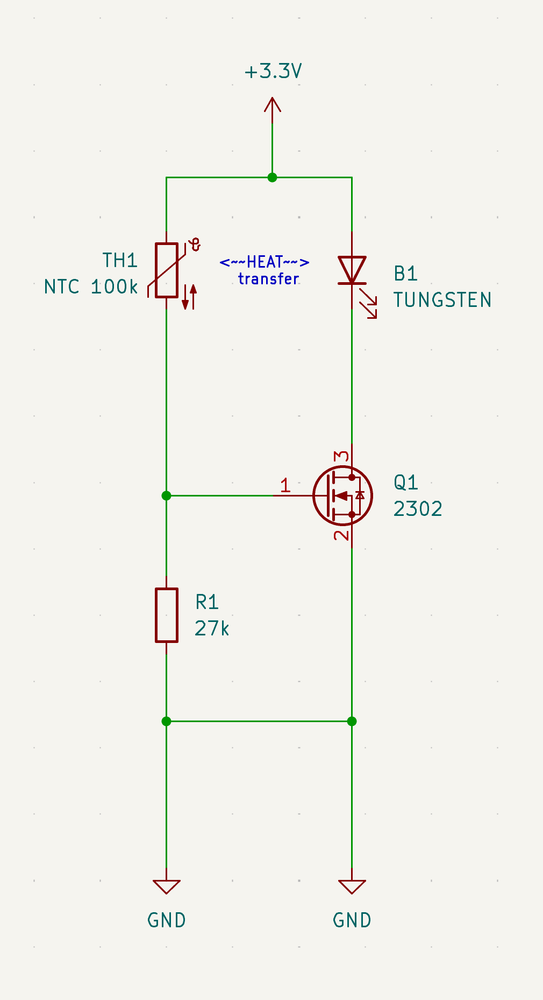
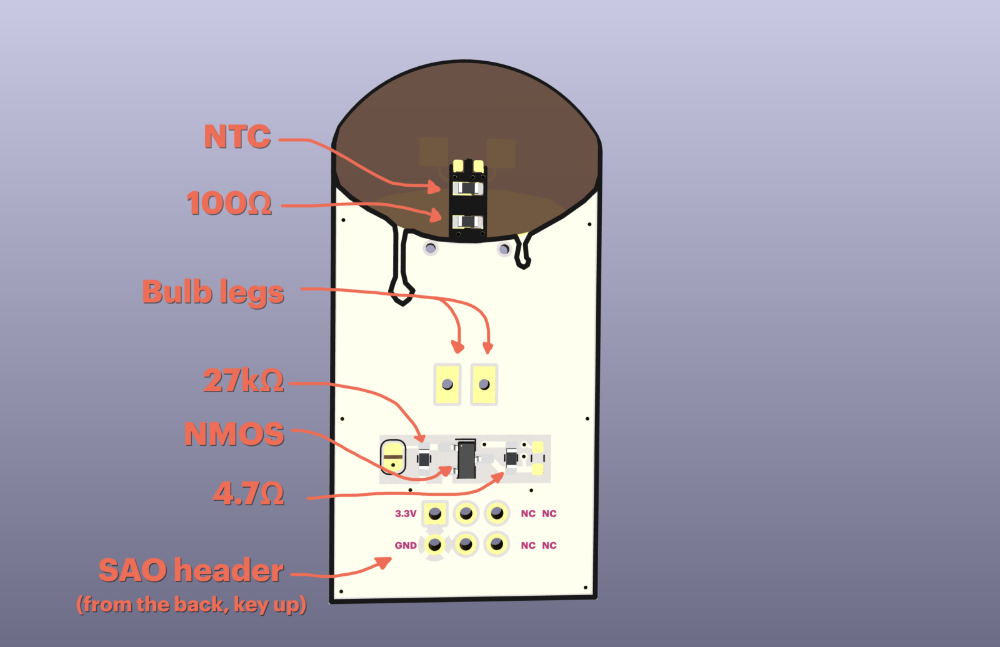

# Skeuomorphicer candle

A more skeuomorphic, electronic candle, that you turn on using a flame and turn off by blowing on it. This is a SAO version of my standalone skeuomorphicer candle.
* It's like a real candle!
* Uses like 5 components
* No MCUs, no op-amps, literarily just one transistor
* The (simplified) schematic looks like a candle

# Simplified schematic and principle of operation

* Heat from flame causes NTC resistance to drop
* This increases the voltage on the gate of the N-MOS, so it should start conducting
* The tungsten bulb now shines, and also produces heat
* The produced heat warms the NTC. The flame can now be removed, and the candle will stay on.
* Blowing on the device temporarily cools the bulb and the NTC
* This disrupts the cycle and causes the candle to shut down

# Actual device
In addition to what is on the simplified schematic, the actual SAO PCB contains:
* A 4.7R resistor to limit the current to the bulb. This is to make it a bit dimmer and warmer, imitating a candle flame more better
* A 130R supplementary heating resistor. To ensure a better thermal latch-on, and make the device more sensitive to being blown out, a resistor placed close to the NTC is providing additional heat. Otherwise the thermal mass of the glass bulb, and the unreliable thermal coupling between it and the NTC makes the candle unreliable.
* Footprints for an LED and resistor, should one want a more power efficient version or a custom, unorthodox colour of light.

# Assembly from kit
If you received a kit at Hackaday Europe 2026, it should contain:

1x PCB
1x tiny tungsten bulb (3V nominal)
1x N-MOSFET 2302V in SOT-23
1x 100k NTC thermistor in 0603 (no marking)
1x 4.7R resistor (marked "4R7")
1x 100R resistor (marked "101")
1x  27k resistor (marked "273")
1x SAO connector

I might have accidentally removed the solder mask on the "wick" part of the candle. It makes soldering the NTC and supplementary heating resistor very hard, as it is very easy to short them to the large 3v3 plane. Sorry! Solder them first, so that you can use a multimeter to test for shorts without other parts interfering.

You can optionally place an LED in the back (or on the top of) the wick, and its current limiting resistor next to the 4.7R one.

# Operational requirements:
Ambient temperature 22.9-23.1 degrees
Vin: 3.25-3.35V
Windspeed: 0-0.5m/s
Outside of these parameters, the candle will probably turn itself on or off unprompted 

